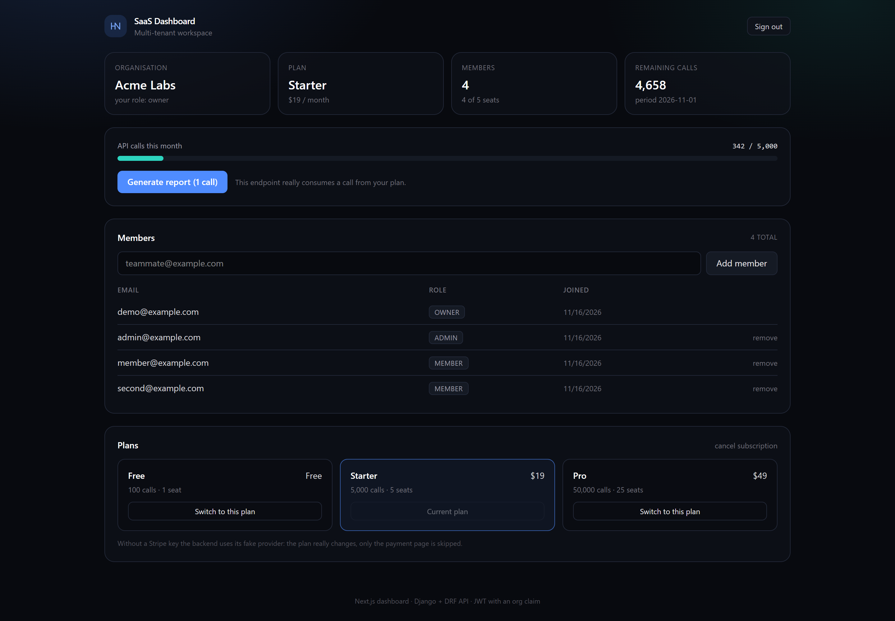

<div align="center">

# SaaS Dashboard

**The frontend for the multi-tenant Django API: sign in, switch tenants, watch a real quota move.**

Next.js 16 · TypeScript · Tailwind 4

[](package.json)
[](tsconfig.json)
[](https://github.com/MrFox2000/django-saas-starter)



</div>

---

## Live

| | |
|---|---|
| **Dashboard** | https://next-dashboard-phi-azure.vercel.app |
| **API** | https://django-saas-api.onrender.com |
| **API docs** | https://django-saas-api.onrender.com/api/docs/ |

The sign-in form is pre-filled with `demo@example.com` / `demo-pass-1234`, the owner
of the seeded **Acme Labs** organisation. Everything on the page comes from the live
API and a real Postgres database — nothing is mocked.

> The free Render API instance sleeps after 15 minutes idle, so the first request
> after a quiet spell can take ~50 seconds while it wakes up.

---

## What it is

This is the other half of [`django-saas-starter`](https://github.com/MrFox2000/django-saas-starter):
a dashboard that talks to that API and nothing else. No mocked data, no fixtures —
every number on the screen comes from a `fetch` against the Django backend.

It exercises the parts of the API that are easy to get wrong in a UI:

- **JWT with an organisation claim.** The token decides which tenant you see, so
  the UI never puts a tenant id in a URL.
- **Role-aware controls.** An `admin` sees the invite form; a `member` sees a
  sentence explaining why they do not.
- **A metered action.** `Generate report` really spends one call from the plan.
  At the limit the API answers `402 Payment Required`, and the UI turns that into
  an upgrade prompt rather than a generic error.
- **Plan switching.** With no Stripe key the backend's fake provider activates the
  plan for real, so the flow is clickable end to end.

## Running it

The backend has to be up first — it owns the data and the auth.

```bash
# terminal 1
git clone https://github.com/MrFox2000/django-saas-starter
cd django-saas-starter/backend
python -m venv .venv && .venv/bin/pip install -e ".[dev]"
python manage.py migrate && python manage.py seed_demo
python manage.py runserver 8002

# terminal 2
git clone https://github.com/MrFox2000/next-dashboard
cd next-dashboard/frontend
npm install
echo "NEXT_PUBLIC_API_URL=http://127.0.0.1:8002" > .env.local
npm run dev -- -p 3002
```

Open <http://127.0.0.1:3002>. The login form is pre-filled with the seeded demo
owner: `demo@example.com` / `demo-pass-1234`.

`seed_demo` creates **Acme Labs** on the Starter plan with four members and 342
used calls, which is why the dashboard has something to show immediately.

## API contract used

| Call | Used for |
|---|---|
| `POST /api/auth/token/` | Sign in, receive JWT with `org_id` |
| `GET /api/orgs/current/` | Org, members, subscription, quota |
| `POST /api/orgs/members/` | Add a member (admin only) |
| `DELETE /api/orgs/members/{id}/` | Remove a member |
| `POST /api/orgs/report/` | **Metered** work, may answer `402` |
| `GET /api/billing/plans/` | Public price list |
| `POST /api/billing/checkout/` | Switch plan |
| `POST /api/billing/cancel/` | Cancel (owner only) |

Errors are normalised in one place ([`src/lib/api.ts`](src/lib/api.ts)): Django's
field errors, `detail` strings, and bare status texts all become an `ApiError`
with a readable `message` and the original `status`.

## Layout

```
src/app/page.tsx           sign-in screen
src/app/dashboard/layout.tsx  auth guard and shell
src/app/dashboard/page.tsx    overview, quota, members, plans
src/lib/api.ts             typed client, token handling, error normalisation
src/lib/types.ts           the API shapes, mirroring the Django serializers
```

## Design decisions

**Why is the token in `localStorage` rather than an httpOnly cookie?** Because the
API lives on a different origin and issues tokens, not sessions. The tradeoff is
real — `localStorage` is readable by any script on the page, so this setup assumes
no third-party scripts and a short 30-minute access token. Moving to cookie-based
auth means adding a token-exchange view on the backend; that is the honest path to
production and is on the roadmap.

**Why one dashboard page instead of three routes?** The whole surface is one
tenant's overview. Splitting members and billing into separate routes would add
navigation without adding clarity, and every section already refreshes from a
single `load()`.

**Why show the raw report JSON?** Because it is what the metered endpoint returns.
Prettifying it would hide the thing that costs money.

## Checks

```bash
npm run lint      # eslint, no warnings
npm run build     # type-checks with TypeScript in strict mode
```

CI runs both on every push.

There is **no component test suite yet** — the honest state of this repository.
The logic that deserves tests (the API client and the quota state machine) lives
mostly on the Django side, which has 29 tests. Adding Playwright coverage for the
login and upgrade flows is the next step.

## Roadmap

- [ ] httpOnly cookie auth with a token-exchange endpoint
- [ ] Organisations switcher when a user belongs to several
- [ ] Playwright tests for sign-in, invite and upgrade
- [ ] Charts for usage over time

## License

MIT
